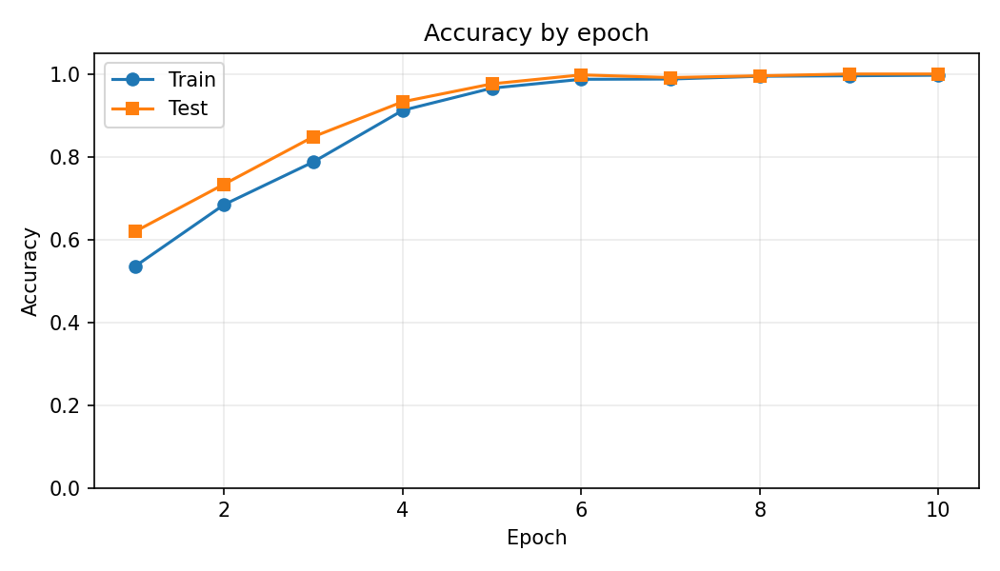
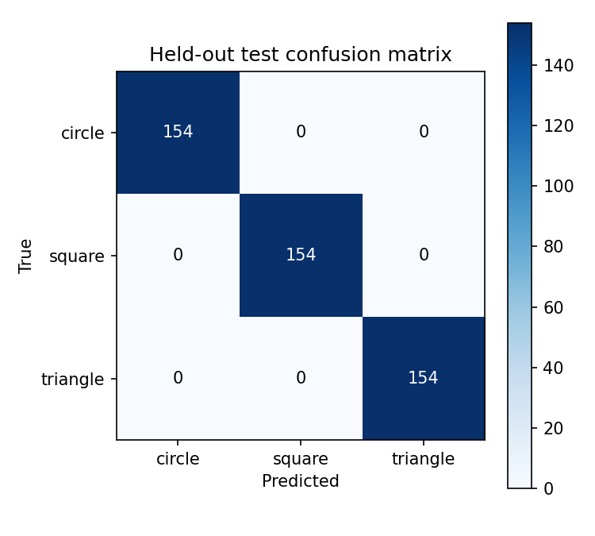

# Deep Computer Vision from Pixels

A complete, executed PyTorch project demonstrating how a convolutional neural network learns to classify **circles, squares, and triangles** from synthetic grayscale images. The dataset is generated locally, so no downloads, pretrained weights, accounts, or API keys are needed.

## Verified results

The included `results/` folder contains the outputs of the actual run, using seed 42 and the default settings. This is an intentionally simple educational benchmark, not a claim of real-world vision performance.

| Experiment | Result |
| --- | ---: |
| Images | 2,100 (700 per class) |
| Image size | 32 × 32 grayscale |
| Train / test | 1,638 / 462 (stratified) |
| Main model | 34,147 trainable parameters |
| Main training | 10 epochs, Adam, LR 0.001 |
| Held-out test accuracy | **100.00% (462/462)** |
| Circle / square / triangle correct | 154 / 154 / 154 |
| No-pooling model | 525,667 trainable parameters |
| No-pooling accuracy | 98.27% after 5 epochs |

The no-pooling ablation has a **different training budget** and therefore is **not** a controlled accuracy comparison; it illustrates how preserving spatial resolution grows the dense layer. Parameter counts are calculated from real model objects.

### Training and diagnostics




Further plots: [samples](results/figures/dataset_samples.png), [Sobel edges](results/figures/sobel_pipeline.png), [training loss](results/figures/training_loss.png), [learned feature maps](results/figures/feature_maps.png), [noise robustness](results/figures/noise_robustness.png), [parameter counts](results/figures/parameter_comparison.png).

## Run it

Use Python 3.10+ in a terminal or Google Colab.

```bash
python -m pip install -r requirements.txt
python project.py
```

This recreates `results/metrics.json`, `results/model.pt`, and all eight figures. You can change the output path with `--output path/to/folder`, or the training duration with `--epochs 10 --ablation-epochs 5`. All operations run on CPU for portable deterministic behavior; Colab does not need a GPU.

Run the included checks:

```bash
python -m unittest discover -s tests -v
```

## What the program does

1. Generates balanced shapes with random position, size, intensity, antialiasing, and Gaussian noise.
2. Uses a stratified, seeded 78%/22% train/test split.
3. Demonstrates manual Sobel filtering and saves a visual comparison.
4. Trains a two-convolution CNN (`1→8→16`, ReLU, 2× max-pooling, `1024→32→3`) from scratch.
5. Records per-epoch training loss, training accuracy, and held-out test accuracy, then saves exact confusion-matrix and classification metrics.
6. Trains a separate model without pooling and reports its size and performance.
7. Tests the primary model on 300 fresh generated samples at each of five Gaussian noise levels.
8. Saves weights, metrics, illustrative figures, and a report.

## Reproducibility and interpretation

`results/metrics.json` is the machine-readable record of the executed run, and `results/run.log` is the terminal output. The saved model is in `results/model.pt`; load only model files you trust. The program fixes NumPy, Python, and PyTorch seeds, and enables deterministic operations. Minor numerical differences may occur across library versions or machines.

The test images are independently generated but come from the **same procedural distribution** as training. The test split is monitored each epoch for educational visualization, **not used to choose a checkpoint**; the reported model is always the one after epoch 10. A validation split would be preferable for serious model selection.

Noise stress-test results (300 fresh images per level):

| Gaussian noise σ | Accuracy |
| ---: | ---: |
| 0.000 | 99.67% |
| 0.075 | 99.67% |
| 0.150 | 92.00% |
| 0.250 | 68.67% |
| 0.400 | 61.67% |

This shows the trained model is not robust to severe distribution changes, despite perfect same-distribution test accuracy.

## Repository layout

```text
deep-computer-vision/
├── project.py
├── requirements.txt
├── README.md
├── .gitignore
├── tests/test_project.py
├── results/
│   ├── metrics.json
│   ├── model.pt
│   ├── run.log
│   └── figures/ (8 PNG plots)
└── PROJECT_REPORT.pdf
```

## Project report

[Read the complete experimental report](PROJECT_REPORT.pdf). The report was rewritten around the executed measurements and corrects the illustrative no-pooling parameter comparison in the original research document.

## License

MIT; see [LICENSE](LICENSE).
